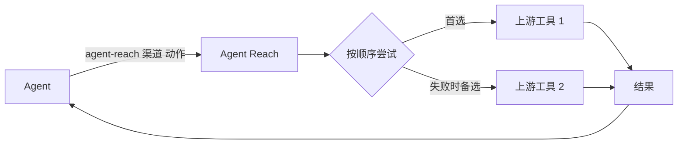

<!-- Modified by xhs-toolkit on 2026-11-01: personal contacts, promotion and personal examples removed; technical and security instructions retained. -->

<h1 align="center">👁️ Agent Reach</h1>

<p align="center">
  <strong>让 AI Agent 够得着它自己上不去的互联网</strong>
</p>

<p align="center">
  登录墙后的平台、视频里的内容、中文平台、干净的结构化数据，一条命令拿到
</p>

<p align="center">
  <a href="LICENSE"></a>
  <a href="https://www.python.org/"></a>
</p>

<p align="center">
  <a href="#快速上手">快速开始</a> · <a href="docs/README_en.md">English</a>
</p>

---

## 为什么需要 Agent Reach？

**Agent Reach 让你的 Agent 真正连上互联网，用上它自己够不着的平台和能力。**

Claude Code、Codex、Hermes Agent、OpenClaw 这类 CLI Agent 自带搜索和网页读取，但下面这些它们基本够不着：

- **要登录才能用的功能**：在小红书搜笔记、在 X 查账号动态、读职位详情等。
- **视频里的内容**：B站和 YouTube 的字幕，以及 YouTube 视频、小宇宙播客的语音转文字。
- **中文平台**：B站、小红书、V2EX、雪球，通用搜索覆盖很差。
- **干净的结构化数据**：雪球行情、V2EX 帖子和回复、GitHub 仓库和 issue，拿到的是整理好的内容。

Agent Reach 把这些平台背后的工具替你装好、测好，Agent 一条命令就能用：

```bash
agent-reach channels                          # 有哪些渠道、每个渠道能做什么
agent-reach bilibili search "大模型"           # agent-reach <渠道> <动作> [参数]
agent-reach read https://www.v2ex.com/t/123   # 按链接自动选渠道
```

### ✅ 在你用之前，你可能想知道

- **适用于哪些 Agent？** 一切 Agent 都能用。
- **会碰我的浏览器和账号吗？** 要登录的平台用 Agent Reach 自己的专用浏览器，在后台运行、不弹窗。第一次用某个网站时，会把你 Chrome 里这个网站的登录复制一份过去，原浏览器不变，不读密码库。复制过来的通常是主账号，建议换成小号，做法见下面的"安全性"。详见[会话配置](agent_reach/skill/references/sessions.md)。

---

## 支持的平台

下表是当前版本的情况。

| 渠道 | 等级 | 能做什么 | 需要什么 |
|---|---|---|---|
| bilibili | 默认 | 搜索、视频信息、热门、字幕 | 无；字幕需要登录（扫码） |
| v2ex | 默认 | 热门、节点、帖子和回复、用户 | 无 |
| github | 默认 | 搜仓库、读仓库/README、读 issue 和 PR（含评论） | 无 |
| youtube | 默认 | 视频信息、搜索、字幕、语音转文字 | 无；转文字需要 Groq 或 OpenAI Key |
| web | 默认 | 网页搜索、网页阅读（保底） | 无 |
| xiaohongshu | 可选 | 搜笔记、读正文、看评论 | 登录 |
| xueqiu | 可选 | 实时行情、搜股票、热帖、热股 | 行情不用登录；热帖、热股要登录 |
| boss | 可选 | 搜职位和 JD | 登录 |
| xiaoyuzhou | 可选 | 播客转文字 | Groq Key |
| linkedin | 可选 | 搜职位、读职位详情 | 公开职位不用登录；站内搜索要登录 |
| reddit | 可选 | 搜帖子、读正文、看评论、看版块 | 登录 |
| twitter | 实验 | 搜推文、用户资料、用户推文、读推文串 | 登录 |
| facebook | 实验 | 搜索、主页资料 | 登录 |
| instagram | 实验 | 搜用户、主页资料、用户帖子 | 登录 |

- **默认**：装好就能用；不想要也可以去掉，以后更新不会再加回来。
- **可选**：说一句"帮我加上 XX"就开启，需要的软件会自动装好。
- **实验**：能用，但平台反爬更严，可能随时失效。

---

## 快速上手

把这句话发给你的 Agent：

```
帮我安装 Agent Reach：https://raw.githubusercontent.com/Panniantong/Agent-Reach/main/docs/install.md
```

无论是安装还是升级，都只需要这一条命令就行了。

剩下的 Agent 自己做完。过程中你可能会被问到：

- **允许它执行命令**：如果 Agent 说自己不能运行命令，去它的设置里打开"允许执行命令"。
- **装 uv**：uv 是一个安装命令行程序的小工具，不需要管理员密码。电脑上没有的话 Agent 会先装它，会跟你说一声。
- **要不要加可选渠道**：装完后 Agent 会告诉你哪些已经能用（B站、V2EX、GitHub、YouTube、网页），以及还能加哪些。你选了再加，也可以以后随时说"帮我加上小红书"，一条命令就装好。

关于登录：部分平台会直接复用你电脑上已有的登录。想换成某个特定账号（比如小号），跟 Agent 说一声就行。Agent 从不替你登录，也不会要你的密码。

> ⚠️ PyPI 上叫 `agent-reach` 的包不是本项目，请勿从 PyPI 安装，只用 install.md 里的 GitHub 地址。

---

## 装好之后怎么管

Agent Reach 装的所有东西（各渠道的工具、登录、设置）都放在你电脑上同一个文件夹里（`~/.agent-reach/`），不散落到别处。所以升级、管理、删除都很省事，一句话就行。

直接用大白话跟 Agent 说：

| 你说 | 它会做什么 |
|---|---|
| "看看 Agent Reach 状态" | 告诉你每个渠道现在能不能用，哪些是上次还好、现在坏了 |
| "加上小红书" / "去掉小红书" | 开启并装好它需要的一切 / 关掉它，清掉它的登录和专用工具 |
| "小红书登录过期了" / "换个账号" / "退出登录" | 打开登录窗口，由你本人登录 / 清掉这个网站的登录 |
| "升级 Agent Reach" | 一次更新程序和各渠道的工具，并告诉你还需要做什么 |
| "卸载 Agent Reach" | 先列出要删的东西，你确认后再删 |
| "让另一个 AI 也能用" | 给那个 AI 也放一份使用说明 |

出了问题，Agent 会告诉你是哪个平台、什么原因、下一步怎么做。常见问题见 [troubleshooting.md](docs/troubleshooting.md)。

---

## 设计理念

### 🔌 每个平台 = 首选 + 备选的有序工具列表

每个平台的每个动作都有一个按顺序尝试的工具列表。比如读 B站视频先用 bili-cli，失败了自动换 B站公开接口；读网页先用 Jina Reader，再用 Exa。



平台改版、工具失效是常态。换工具只是调整这个列表，Agent 的用法不变。

---

## 安全性

- **只读**：只搜索和读取，不发帖、不评论、不点赞、不私信。
- **从不替你登录，也不要你的密码。** 部分平台会复用你电脑上已有的登录（只复制这一个网站，原浏览器不变）；确实需要重新登录时才打开专用窗口，由你本人完成。
- **专用浏览器只对你这台电脑开放**，别的电脑连不上它。
- **建议用小号登录。** 复用过来的通常是主账号，而平台可能限制自动访问的账号。想换成小号，跟 Agent 说一声就行。
- **Key 不要发在聊天里**：在你自己的终端里运行 `agent-reach configure groq-key` 填写。

### 🗑️ 卸载

跟 Agent 说"卸载 Agent Reach"。它会先列出要删的东西，你确认后再删。只删 Agent Reach 自己装的东西，你的其他文件和浏览器都不动。最后它会告诉你怎么删掉程序本身。

---

## 致谢

[OpenCLI](https://github.com/jackwener/opencli) · [bili-cli](https://github.com/public-clis/bilibili-cli) · [boss-agent-cli](https://github.com/can4hou6joeng4/boss-agent-cli) · [yt-dlp](https://github.com/yt-dlp/yt-dlp) · [Jina Reader](https://github.com/jina-ai/reader) · [Exa](https://exa.ai)

## 防骗提醒

Agent Reach 没有官方代币、币、投资产品、领取手续费活动、钱包连接，也没有 Solana/Pump.fun 项目。任何借用 Agent Reach 名字、GitHub 地址或作者身份的加密项目都与本仓库无关，请勿据此连接钱包或领取任何费用。

## License

[MIT](LICENSE)
